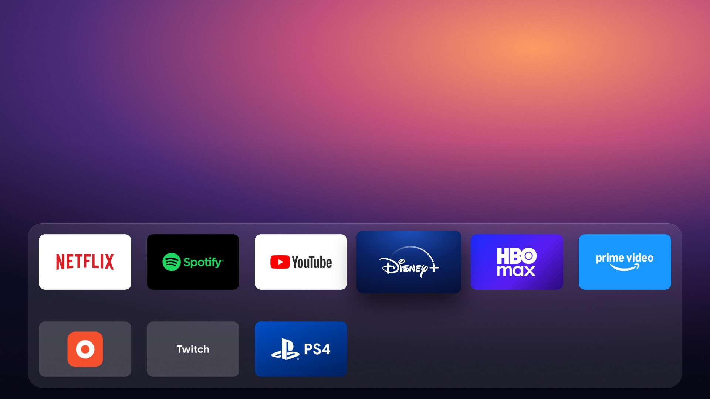
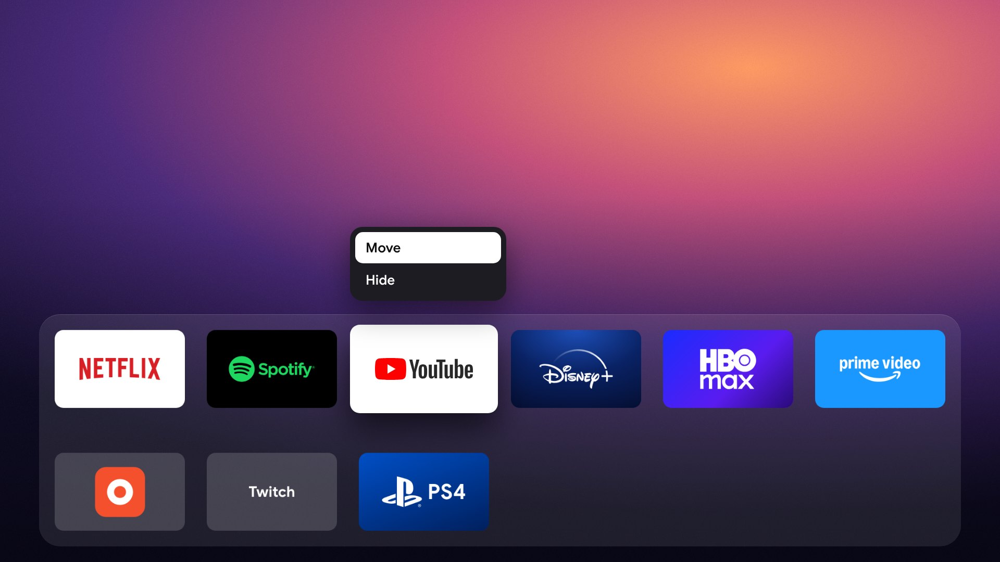
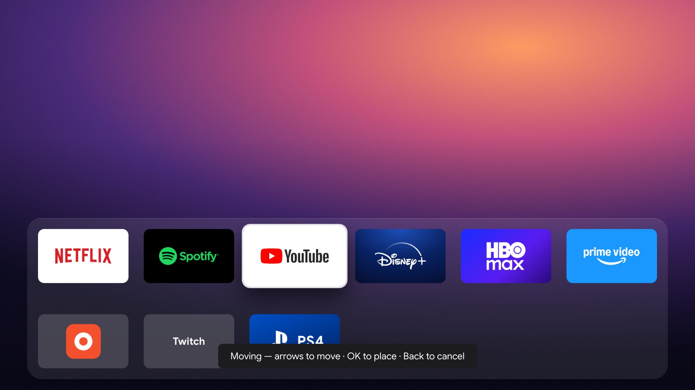

# iTV

A tvOS-style Home for a Samsung U8600F (2025, Tizen 9), built on
[AeroTizen](https://github.com/helalaou/AeroTizen) Native Home. It replaces Samsung's
home screen with a quiet grid of app tiles over a generated "Dusk" wallpaper, driven
entirely by the standard Samsung remote. No root is used.

The launcher is installed on the TV and runs there. A Mac builds, installs and repairs it;
everyday viewing does not need another device.

## What it does

<table>
  <tr>
    <td></td>
    <td></td>
  </tr>
  <tr>
    <td></td>
    <td></td>
  </tr>
</table>

- **Grid:** six columns, anchored at the bottom of the screen under one frosted plate. The
  upper half is left to the wallpaper.
- **Tiles:** official logos on brand colours for Netflix, Spotify, YouTube, Disney+, HBO Max
  and Prime Video. Apps installed later get the TV's own icon. A PS4 tile appears only
  while the console is connected. No labels under tiles.
- **Focus:** the focused tile lifts with a soft shadow. Edges stop with a small bump.
  Quick repeated arrows move focus instantly instead of queueing animations.
- **Hidden Apps tile:** pressing Down on the last row reveals it; Up hides it again. It
  opens Samsung's app store.
- **Hold OK:** opens Move and Hide for any app tile.
- **Opening and returning:** opening an app from its tile grows the tile and fades to
  black. Pressing Home in that app fades the Home back in while the tile settles.
- **Power-on:** opens the Home focused on the last-used app, so one OK resumes it. Back
  never leaves the Home.
- **Sound:** short synthesised taps (the "Felt" set), with no audio files.
- **Settings:** the remote's own settings button opens Samsung's menu, so the Home has no
  Settings tile.

Screenshots are rendered in a desktop browser with sample apps. The design and its
rationale are in [docs/design/home-ui.md](docs/design/home-ui.md).

## Status

| Milestone | State |
| --- | --- |
| Native Home on this TV | Proven: cold boot, standby wake, app launch, Home return, Samsung Home restore and reapply. See [stock proof](docs/stock-proof.md). |
| iTV Home | Installed and accepted on the TV on 2026-11-17. See [UI integration](docs/ui-integration.md). |
| Later | [Top shelf / recommendations](https://github.com/guivalenca/iTV/issues/1), [booting straight into the last app](https://github.com/guivalenca/iTV/issues/2), [reaching AeroTizen's own settings](https://github.com/guivalenca/iTV/issues/3). |

## How it works

iTV does not fork AeroTizen. It pins one upstream commit and applies small patches:

| Patch | What it changes |
| --- | --- |
| [0001](patches/0001-launcher-no-automatic-update-check.patch) | Removes the launcher's update check, so the installed build never contacts GitHub. |
| [0002](patches/0002-itv-home-ui.patch) | Adds the iTV Home as a new module (`launcher/src/itv/`) and mounts it in place of AeroTizen's Home. Outside that module it only adds launch-failure callbacks, optional boot flags and motion tokens. |

The `DclHome001.Home` and `DclHome001.Watcher` identities, the background service and the
Native Home integration are unchanged. The only manifest addition is the `tv.audio`
privilege, used to compare our sounds with Samsung's native ones.

[`scripts/build.py`](scripts/build.py) clones the pinned commit from
[upstream.lock.json](upstream.lock.json), applies the patches and builds the launcher
package and the AeroTizen CLI. It then runs upstream's checks: formatting, lint, types,
Node, component, service and Python tests, plus the native policy harness. It never
connects to a TV.

## Repository layout

| Path | Contents |
| --- | --- |
| `patches/` | The patches applied to pinned AeroTizen |
| `scripts/` | Build, recovery-backup and Home-status helpers |
| `tests/` | Tests for those scripts |
| `docs/design/` | The Home design spec and the implementation handoff log |
| `docs/` | Build instructions, device proof, integration results and research notes |

## Building and installing

Follow [docs/build.md](docs/build.md). Installing needs Developer Mode on the TV, the
AeroTizen CLI built here and the Samsung signing profile. The device order, backup and
restore steps are documented there and in [docs/stock-proof.md](docs/stock-proof.md).

## Keeping the TV working

- **Keep firmware updates off and decline update prompts.** An update could replace the
  Home routing or break Native Home.
- **The launcher does not update itself:** patch 0001 removed the update check.
- **Never uninstall the launcher while Native Home is active.** Restore Samsung's home
  first.
- **Keep the original Home backup and the signing certificates private.** Keep them
  outside this repository, with a second copy off the Mac. Updates must be signed with
  the same certificates.

## Credits and licence

iTV is MIT-licensed; see [LICENSE](LICENSE). It is built on AeroTizen by Hamza El Alaoui,
also MIT. App logos are trademarks of their owners and are used only to identify the
installed apps. See [THIRD_PARTY_NOTICES.md](THIRD_PARTY_NOTICES.md).

This is a personal project. It is not affiliated with Samsung, Apple or any of the app
publishers.
